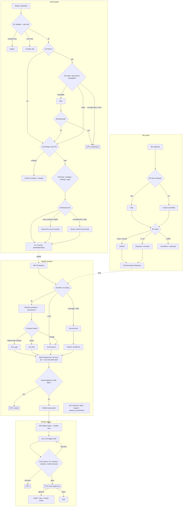

# Greystones Dog Fouling Map: graph engineering design

- Date: 2026-10-16. Companion to PRD.md.
- **Graph engineering** (Conor's definition): agents prompt themselves by running a graph of branching nodes with many possible outcomes, rather than a single loop. Each node reads typed state, decides a branch, writes state, and may emit a prompt for the next node. Deterministic nodes (SQL or geometry) are preferred. LLM or vision nodes are used only where judgement is needed, and every LLM output is validated against a schema before it can branch.

Implementation: Supabase Edge Functions as nodes, with a `graph_runs` row as durable state (LangGraph-style: nodes, conditional edges, checkpoints). The graphs are triggered by DB webhooks (intake) and `pg_cron` (sweeps, analysis, digest). Every run is replayable from its checkpoint.

## 1. Graphs
- **G1 Intake graph:** per report or photo, in real time.
- **G2 Bin graph:** per bin add or vote.
- **G3 Analysis graph:** nightly and on demand. It covers hotspots, bins vs fouling, and lifecycle.
- **G4 Digest graph:** weekly. It drafts the councillor email for a human to send.
- **E1 Email builder:** a client-side subgraph that reuses N8/N9 outputs.

## 2. State schema
```ts
type ReportState = {
  run_id: string; report_id: string; device_id: string;
  raw: { lat: number; lng: number; accuracy_m: number; photo_path?: string; note?: string };
  validation?: { ok: boolean; reasons: string[] };          // N1
  rate?: { allowed: boolean; recent_count: number };         // N1
  vision?: { is_dog_mess: number; has_face: boolean; has_plate: boolean;
             has_house_number: boolean; confidence: number }; // N3
  photo_action?: 'publish' | 'blur_then_publish' | 'hold' | 'reject' | 'none';
  dedupe?: { action: 'new' | 'merge' | 'confirm'; target_id?: string; distance_m?: number };
  snap?: { snapped: boolean; street?: string; private_curtilage: boolean; offset_m: number };
  bin_distance?: { all_m: number; verified_m: number | null; dog_m: number | null;
                   nearest_bin_id?: string; nearest_status?: string };
  final_status?: 'spotted' | 'pending' | 'rejected' | 'merged';
  errors: { node: string; msg: string; retry: number }[];
  hitl?: { queue: 'moderation'; reason: string };
};

type AnalysisState = {
  run_id: string; period: { from: string; to: string };
  reports: number; coverage: number;                         // share of hotspot cells bin-surveyed
  bands: { le50: number; le100: number; le200: number; gt200: number };
  baseline: { n: number; bands: { le50: number; le100: number; le200: number; gt200: number } };
  ci: Record<string, [number, number]>;
  verdict: 'bins_gap' | 'not_bins' | 'inconclusive' | 'insufficient_coverage';
  hotspots: { h3: string; count: number; d_bin_verified_m: number;
              tag: 'far_from_bin' | 'near_bin_still_fouled' | 'other' }[];
  lifecycle: { staled: number; reconfirm_prompts: number };
};

type DigestState = {
  run_id: string; analysis_run_id: string;
  recipients: string[];            // default: 6 Greystones MD councillors + envcomplaints
  citations: string[];             // citation ids, status=verified only
  draft?: { subject: string; body: string };
  checks?: { no_pii: boolean; stats_match_db: boolean; citations_verified: boolean };
  approval: 'pending' | 'approved' | 'rejected';
};
```

## 3. Nodes, branches and conditions

### G1 Intake
| Node | Type | Branches (condition → next) |
|---|---|---|
| **N1 Validate + rate limit** | deterministic | Point outside study polygon → **reject** ("outside Greystones MD"). Accuracy over 75 m → **ask user to adjust pin** (client), continue with flag. Device over limit → **throttle** (429), end. OK → N2. |
| **N2 Photo present?** | deterministic | No photo → N4. Photo → N3. |
| **N3 Photo classify + privacy** | vision LLM, JSON schema | `has_face`, `has_plate` or `has_house_number` with confidence ≥0.6 → **blur** (server-side box blur on detected regions) → re-check; still detected → **hold** (HITL). `is_dog_mess` <0.3 → **hold** ("may not be dog mess"); report kept as pending. `is_dog_mess` ≥0.3 and clean → **publish**. Model error or timeout → retry ×2 → **hold** (fail closed: never publish an unchecked photo). |
| **N4 Dedupe** | PostGIS | An open report within 15 m and 72 h → **confirm** (increment confirmations on target, mark this one `merged`). Within 15–30 m and 72 h, same device → **merge**. Else → **new**. |
| **N5 Snap to street** | PostGIS vs OSM footways | Inside private curtilage polygon → **snap** to nearest public way, or blur to 25 m if over 40 m away. Within 10 m of a footway → **snap**. Else (beach, park) → **keep raw**. Snapping avoids Google Geocoding cost; street name comes from the OSM way. |
| **N6 Nearest-bin distance** | PostGIS KNN | Computes `all_m`, `verified_m` and `dog_m`. No verified bin within 500 m → set `verified_m=null` and enqueue a **bin-survey prompt** for that H3 cell (shown to the next users nearby). Nearest bin unverified and under 30 m → enqueue **confirm-bin prompt**. → N7. |
| **N7 Commit** | deterministic | Writes final status: `spotted` (public), `pending` (HITL), or `merged`. Emits a realtime event so the map updates. |

### G2 Bin graph
| Node | Branches |
|---|---|
| **B1 Bin add / vote intake** | New bin within 10 m of an existing bin → treat as a **yes vote** on the existing one. Else create `unverified`. |
| **B2 Status update** | ≥2 distinct yes votes within 90 days, or `source=council` → **verified**. ≥2 distinct no votes and no-votes outnumber yes-votes (non-council) → **disputed**; disputed and 2 more no-votes → **removed** (soft). `last_confirmed_at` over 180 days → back to **unverified** and re-prompt. |
| **B3 Recompute affected reports** | Recompute `d_bin_*` for reports within 500 m; mark the analysis as dirty. |

### G3 Analysis graph (nightly)
| Node | Branches |
|---|---|
| **N8 Hotspot detection** | Aggregate open and recent reports to H3 r9 over 30 days. A cell with ≥5 reports, or ≥3 with a rising week-on-week trend, → hotspot. Tag `far_from_bin` (centroid over 200 m from a verified bin) or `near_bin_still_fouled` (under 50 m). |
| **N10 Bins vs fouling** (the new core node) | 1) Compute coverage. **Coverage <0.7 → verdict `insufficient_coverage`**, then branch to *N10b survey push* (pick the 5 un-surveyed hotspot cells and prompt users there), then end analysis output with an "inconclusive" label. 2) Reports <30 → `inconclusive` (sample too small). 3) Else sample 10×N random points in the walkable mask, compute the bands, and bootstrap a 95% CI. Report share >200 m significantly above baseline → `bins_gap`. Significantly below → `not_bins`. Overlapping CI → `inconclusive`. 4) Always output *both* hotspot lists (far-from-bin and near-bin-still-fouled), whatever the verdict. 5) Sanity check: if a verdict flips versus the last run while N changed by under 10% → flag for HITL review before publishing. |
| **N11 Lifecycle** | Spotted with no confirmation for over 14 days → **stale** (grey). Stale with a new nearby report → re-open. Cleared without a photo or second confirmation within 48 h → `cleared_unconfirmed`. Cleared photos are deleted after 90 days. |

### G4 Weekly digest graph
| Node | Branches |
|---|---|
| **N9 Citation picker** | Input: template intent (bin request, enforcement, general) plus the location type from N5 (beach, road, park). Rules first: always L1 (s.22(1)) plus L5 (€250). Beach → add L2(d). Park or playing field → L2(c). Bin request → L7 (LMP "bins for disposal" objective). Only `status=verified` rows. No verified match → cite L1 only. |
| **N12 Digest builder (LLM)** | Input: N8 + N10 + N11 outputs and N9 citations. Prompt: factual, polite, no names, numbers verbatim from state. Output: JSON `{subject, body}`. |
| **N13 Guard checks** | Regex and LLM check for PII (names, house numbers, plates). Every number in the body must exactly match a state value. Citations must be verified. N10 verdict `inconclusive` or `insufficient_coverage` → body must not claim a bin gap. Any check fails → regenerate once with errors fed back as the next prompt (self-prompting edge) → still failing → send to HITL with diffs. |
| **N14 HITL approval** | Conor reviews the draft in admin. Approve → the app produces a `mailto:` and copy for **Conor to send himself**. Reject → end. **There is no automatic send path anywhere in the graph.** |

### E1 Email builder (resident, client-side)
Reuses N9 (citations) and N10 (bin stat sentence) via a `/api/email-context?h3=` endpoint, which returns pre-validated sentences. The resident edits freely and the client opens `mailto:` or copies the text. No server send.

## 4. Human-in-the-loop points
1. N3 hold: uncertain privacy or not-dog-mess photos go to the moderation queue.
2. Flags: 2 flags hide an item until reviewed.
3. N10 verdict flip with little new data, and before publishing the first-ever verdict.
4. N14: every digest email. A human sends it.
5. B2: disputes involving `source=council` bins are admin only.

## 5. Failure paths
| Failure | Behaviour |
|---|---|
| Vision API down | Report saved with no public photo, photo held (fail closed), retry with backoff ×3 over 1 h, then moderation queue |
| PostGIS or snap error | Keep raw point, `snap.snapped=false`, log the error, continue |
| No bins at all in radius | `verified_m=null`; excluded from bands but counted in a "no bin within 500 m" bucket shown in the panel |
| Analysis job timeout | Keep the last good `bin_analysis_runs` row, label the panel "as of <date>" |
| LLM digest invalid JSON or guard fails twice | HITL with the raw draft. Never auto-publish. |
| Councillor CSV stale (quarterly check finds diffs) | Disable "All councillors" until Conor approves the updated list |
| Abuse spike (more than 50 reports per hour) | Circuit breaker: new reports go to pending, admin is alerted |

## 6. Diagram


## 7. Self-prompting edges
- N13 → N12: guard failures become the next prompt ("Remove the house number '14'. The number 61% doesn't match state value 58%").
- N10 → N10b: low coverage produces prompts to *users* at specific cells. The graph steers its own data collection.
- N6 → confirm-bin prompts: each report is a chance to verify bin data.
- N3 → blur → N3: re-checks its own output before publishing.
